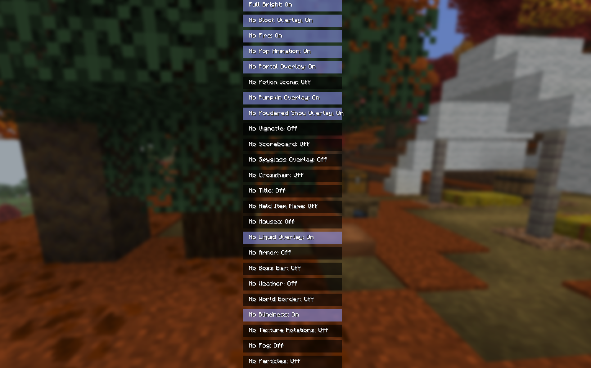

# NoRender

NoRender is a fully customizable client-side Fabric mod designed to clean up your view and give you total control over what is displayed on your screen. If you are tired of intrusive screen overlays, cluttered HUD elements, or annoying visual effects, this mod allows you to easily disable exactly what you don't want to see.

## 🛠 How to Use

You can easily access the configuration screen in two ways:

• Via Mod Menu (by clicking the configure button on the mod list).

• Directly from the vanilla game menus via Options ➔ Accessibility Settings.

